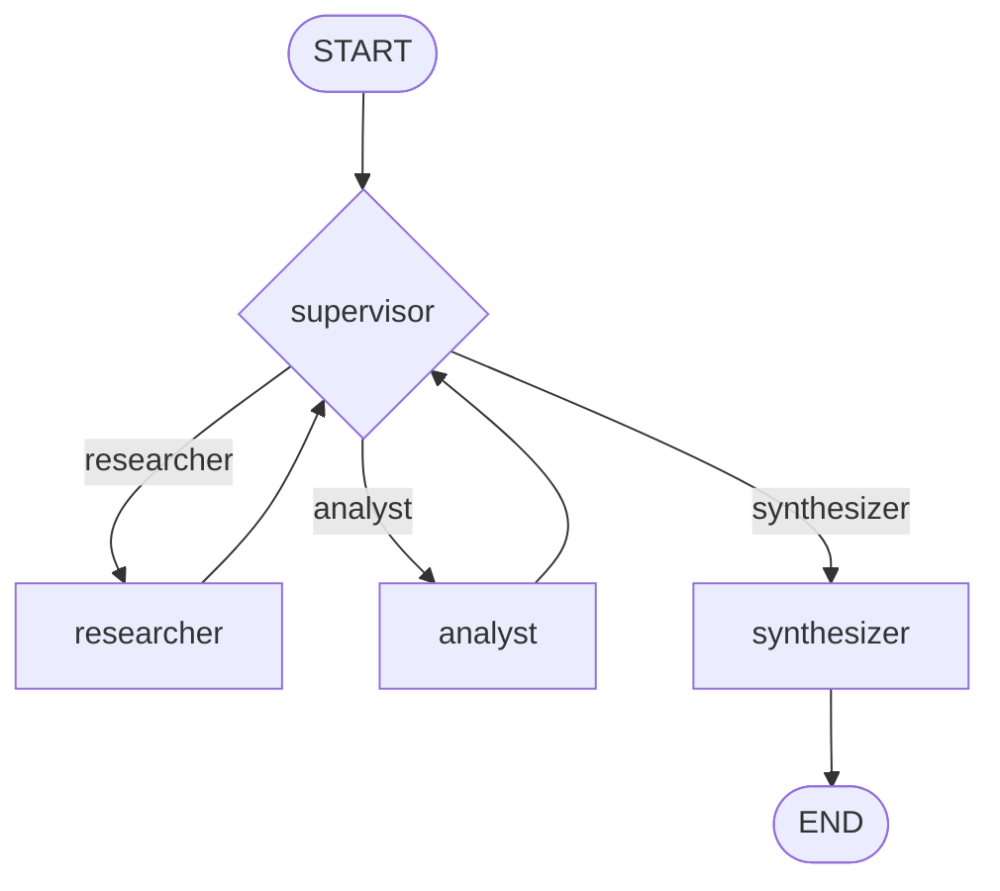

# Orquestador multi-agente de análisis e investigación

Prototipo de un sistema multi-agente con **LangGraph** donde un **Supervisor** reparte el trabajo entre un **Investigador**, un **Analista** y un **Sintetizador**. Funciona 100 % en local con **Ollama** (`qwen3:4b-instruct` para el chat y `bge-m3` para los embeddings): sin claves de API y sin enviar datos a terceros.

El dominio de ejemplo es una cooperativa ficticia de huertas urbanas, **Huerta Viva**. El sistema responde preguntas que exigen dos dominios distintos: consultar documentos (reglamento, cuotas, normas) y analizar datos (sentimiento de reseñas de socios, cálculos).

> **Ejemplo de consulta:** *"Investiga cuánto cuesta la cuota para un socio jubilado y qué opinan los socios sobre las cuotas. Dime el porcentaje de opiniones positivas y calcula cuánto pagaría un jubilado en un año."*

## Topología

Hub-and-spoke (jerárquica): todos los especialistas **vuelven al supervisor**, que es el único que decide el siguiente paso.



El diagrama exportado por LangGraph (`graph.get_graph().draw_mermaid_png()`) está en [`assets/graph.png`](assets/graph.png), y su código Mermaid en [`assets/graph.mmd`](assets/graph.mmd).

| Nodo | Rol | Herramientas |
|---|---|---|
| `supervisor` | Router y controlador de flujo. No hace el trabajo: decide quién actúa, valida con una rúbrica y fuerza el cierre | Ninguna (salida estructurada con `Literal`) |
| `researcher` | Busca información | `buscar_reglamento` (ChromaDB, búsqueda híbrida), `buscar_resenas` (ChromaDB) |
| `analyst` | Procesa datos con precisión | `analizar_sentimiento_resenas`, `calcular` |
| `synthesizer` | Redacta la respuesta final | Ninguna |

### Por qué esta topología

- **Un solo árbitro.** Si los agentes se llamaran entre sí (red), habría que resolver quién manda cuando dos discrepan. Con el supervisor como único nodo que enruta, ese problema no existe.
- **Más flexible que un pipeline fijo.** Un flujo `investigar → analizar → responder` siempre ejecutaría el analista, aunque la pregunta sea "¿cuándo es la asamblea?". Aquí el supervisor decide según la pregunta y el estado.
- **Permite refinar.** Como el control siempre vuelve al supervisor, este puede pedir a un especialista que corrija su resultado antes de cerrar.
- **Es adecuada para un modelo pequeño.** Un modelo de 4B no es fiable coordinando una conversación libre entre agentes; sí lo es eligiendo entre tres opciones con un esquema estricto, y las guardas en código cubren sus errores.

## Estado compartido (`state.py`)

`AgentState` hereda de `MessagesState`. Cada campo tiene un dueño, de modo que se sabe quién aportó qué y no se pierde contexto.

| Campo | Dueño | Para qué |
|---|---|---|
| `next_agent`, `instruction`, `supervisor_feedback` | supervisor | A quién se enruta, con qué tarea y qué corregir |
| `step_count`, `refinements` | supervisor | Contadores anti-bucle |
| `research_output` | researcher | Fragmentos, reseñas, resumen y errores de herramientas |
| `analysis_output` | analyst | Sentimiento (conteos y porcentajes), cálculos y resumen |
| `final_answer`, `task_completed` | synthesizer | Respuesta y bandera de cierre |
| `contributions` | todos | Registro de trazabilidad `{agente, paso, resumen}`. Usa un *reducer* (`operator.add`): **se acumula, nunca se pisa** |

## Cómo decide el supervisor

Dos capas, pensadas para un modelo pequeño:

1. **El LLM decide** (`with_structured_output` con `Literal["researcher", "analyst", "synthesizer"]` más `reason` e `instruction`). Su prompt incluye una **rúbrica de validación**: ¿hay fuentes del investigador?, ¿los números vienen de herramientas y no de memoria?, ¿se cubre todo lo que pidió el usuario?, ¿cada cifra se puede rastrear a un dato investigado? Solo si se cumple, elige `synthesizer`.
2. **Guardas deterministas en Python** corrigen las decisiones que rompen las reglas y garantizan que el flujo termina.

Si la salida estructurada del LLM falla, el supervisor enruta con reglas de respaldo en lugar de romperse.

## Manejo de conflictos entre agentes y bucles

| Riesgo | Mecanismo |
|---|---|
| Dos agentes se contradicen o se pisan | Nadie se comunica con nadie: todo pasa por el supervisor. Cada campo del estado tiene un único dueño y `contributions` solo acumula |
| "Supervisor infinito" | `MAX_STEPS` (8): al superarlo, el flujo va al sintetizador. `MAX_REFINAMIENTOS` (1): un especialista no puede repetirse sin fin |
| El supervisor decide algo absurdo | Guardas: no sintetizar sin datos, no sintetizar sin analizar lo que la pregunta exige, no repetir a un agente sin refinamientos disponibles |
| Un especialista falla o no encuentra nada | Los errores de herramientas se guardan en el estado, el supervisor los ve y decide; el flujo termina siempre |
| El modelo inventa cifras | Los porcentajes y cálculos los hace Python (`calcular` evalúa con `ast`, sin `eval`); el LLM solo etiqueta cada reseña |
| El modelo inventa "limitaciones" | El LLM no las redacta: se eliminan y las reales se calculan desde el estado (límite de pasos, errores, muestra de reseñas) |

**Contaminación de contexto:** cada especialista recibe solo su instrucción y un resumen, no todo el historial. Las herramientas devuelven al LLM un texto corto y dejan los datos completos en un `artifact`, que el nodo copia al estado sin que el modelo tenga que reescribirlos. El analista lee las reseñas directamente del estado mediante `InjectedState`.

## Búsqueda híbrida

Los embeddings distinguían poco entre fragmentos largos que mezclan varios temas: en una prueba real, el fragmento que respondía una pregunta quedó en la posición 4 y al agente solo le llegaban 3. `retrieval.py` combina la similitud semántica con coincidencia de palabras clave (ponderadas por IDF, tolerantes a tildes y variantes) mediante Reciprocal Rank Fusion. Con esa pregunta, el fragmento correcto pasó a la posición 2. `diagnostico_busqueda.py` muestra ambos órdenes.

## Estructura del repositorio

```
├── state.py                  # Esquema de estado compartido
├── agents/
│   ├── research_agent.py     # Investigador (create_react_agent)
│   ├── analyst_agent.py      # Analista (create_react_agent)
│   ├── synthesizer_agent.py  # Sintetizador
│   └── common.py
├── tools/
│   ├── search_tools.py
│   └── analysis_tools.py
├── supervisor.py             # Nodo supervisor, rúbrica y guardas
├── prompts.py
├── graph.py                  # StateGraph, nodos y aristas condicionales
├── main.py                   # CLI
├── retrieval.py              # Búsqueda híbrida
├── vector_db.py, llm.py, config.py
├── ingest_resenas.py         # Indexa las reseñas en ChromaDB
├── data/resenas.json         # 24 reseñas ficticias creadas para este ejercicio
├── vectorstore/              # ChromaDB: colecciones rag_docs y resenas_huerta_viva
├── demo.ipynb                # Demo del flujo de delegación (3 casos)
├── test_graph.py, test_tools.py, test_retrieval.py, diagnostico_busqueda.py
└── assets/graph.png, graph.mmd
```

## Puesta en marcha

Requisitos: Python 3.10 o superior y [Ollama](https://ollama.com) corriendo.

```bash
ollama pull qwen3:4b-instruct
ollama pull bge-m3

python3 -m venv .venv
source .venv/bin/activate
pip install -r requirements.txt

cp .env.example .env
python ingest_resenas.py          # indexa las reseñas (la colección rag_docs ya viene en vectorstore/)
python main.py                    # consulta de demostración
python main.py "¿Cuándo es la asamblea general y quién preside el consejo coordinador?"
python main.py --diagram          # exporta el diagrama
```

Variables del `.env` (todas opcionales): `LLM_MODEL`, `EMBEDDING_MODEL`, `NUM_CTX` (4096 cabe en una GPU de 4 GB), `MAX_STEPS`, `K_DOCS`, `K_RESENAS`.

> **Importante:** `bge-m3` debe ser el mismo modelo con que se indexó `rag_docs` (1024 dimensiones). Con otro modelo, las búsquedas devuelven resultados sin sentido.

## Pruebas

```bash
python test_tools.py            # herramientas, sin Ollama
python test_tools.py --ollama   # además contra Ollama y el vectorstore real
python test_retrieval.py        # búsqueda híbrida, sin Ollama
python test_graph.py            # grafo completo con un LLM simulado, sin Ollama
```

`test_graph.py` usa un modelo simulado para verificar lo que **no** depende del LLM: enrutamiento, guardas, límites anti-bucle, refinamiento, respaldo ante salidas inválidas, errores de herramientas, ejecución concurrente y limitaciones calculadas. No mide la calidad del modelo real; eso se ve en `demo.ipynb` y `main.py`.

## Demo

[`demo.ipynb`](demo.ipynb) muestra el flujo de delegación en tres casos: una consulta completa (investigar, analizar, cerrar), una pregunta simple en la que el supervisor no llama al analista, y la protección anti-bucle con un límite de 2 pasos.

## Limitaciones conocidas

- **Modelo pequeño y no determinista.** Con un modelo de 4B, dos ejecuciones de la misma consulta pueden diferir: a veces el analista se equivoca en un cálculo y el supervisor lo corrige (refinamiento); otras sale bien a la primera.
- **Clasificación de sentimiento sin validación formal.** El LLM etiqueta cada reseña (positivo, neutral, negativo). Las etiquetas de referencia de las pruebas las definió el autor y los casos ambiguos son subjetivos.
- **Datos pequeños y ficticios.** 12 fragmentos de documentos y 24 reseñas creadas para el ejercicio. Los porcentajes se calculan sobre las reseñas recuperadas; si son menos que el total, la respuesta lo indica.
- **Búsqueda híbrida validada en un caso.** La mejora se comprobó con una pregunta concreta y fragmentos reales. La palabra clave sola falla en otras (por ejemplo, "¿qué no se puede compostar?"); por eso se fusiona con la semántica en vez de sustituirla.
- **Heurística de análisis necesario.** Que una pregunta exija análisis se detecta con palabras clave (porcentaje, opinión, calcular...). Una pregunta con otra formulación podría no activarla.
# Orquestador-multi-agente-especializado
